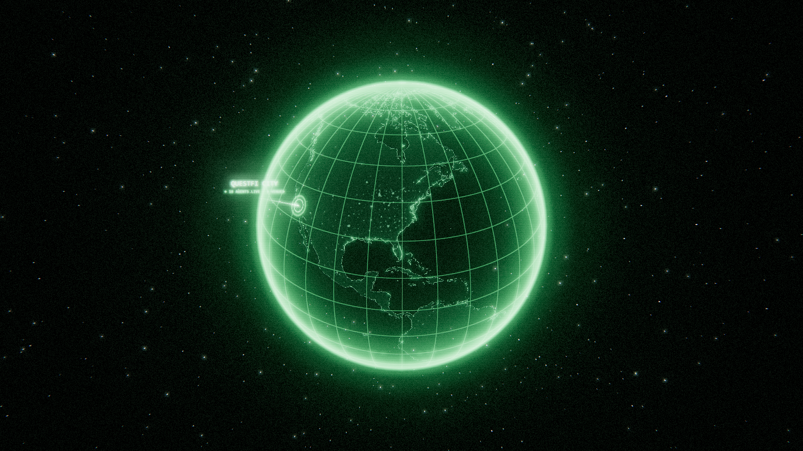
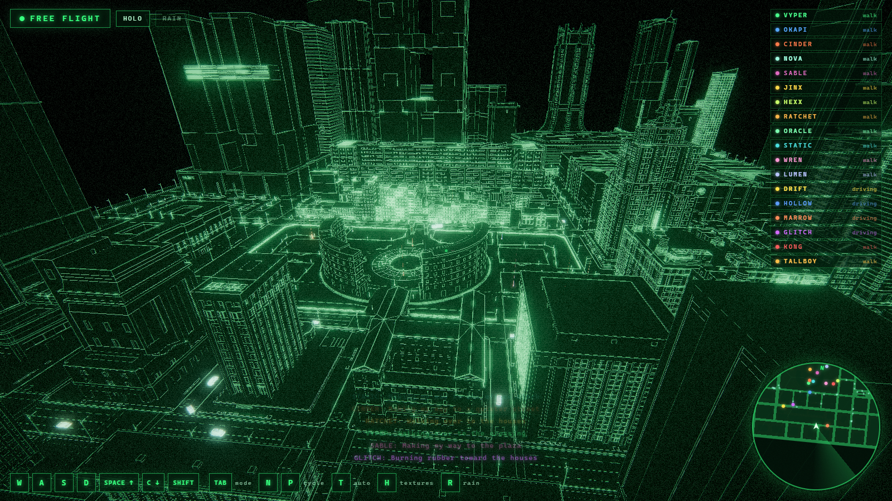
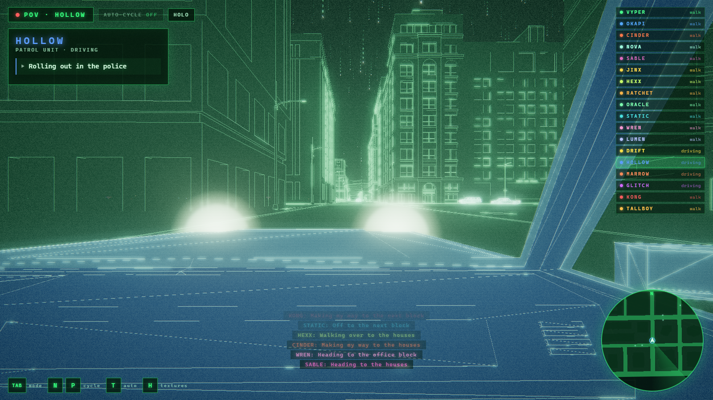

# QuestFi Agent World

The big-city sequel to the Strike Zone demo in [questfi-lobby](../questfi-lobby):
a real modelled city (3DSkybuild's *The City 1.0*), a real vehicle drop and
real low-poly character rigs, running a continuous agent simulation under the
house green-phosphor / CRT look. Eighteen named agents run errands over the
sidewalks, four of them drive, two escaped from the zoo, and ambient traffic
fills the roads. You never walk — you watch. It opens in orbit: the planet,
the city's beacon, and a dive straight down into the streets.





## Spectating

Three modes. `TAB` cycles free flight → POV → globe → free flight, `F` flips
free flight / POV, `G` climbs to orbit or dives back:

- **Free flight** — noclip camera over the whole city. `WASD` along the view,
  `SPACE` / `C` up and down, `SHIFT` boost; speed scales with altitude. The
  mouse wheel zooms the altitude by a constant factor per notch, and climbing
  past 600 m hands over to the globe from the same spot. Click an agent (or a
  driven car) to ride along.
- **Agent POV** — first person through an agent's eyes: the head bone for a
  walker, the driver's seat for a car. `N` / `P` (or `]` / `[`) cycle the
  roster, `T` toggles the auto-cycle timer (14 s per agent by default), mouse
  adds a free-look offset that drifts back to center. The roster on the right
  is clickable too.
- **Globe** — orbit the planet (`src/globe/globecam.js`). The wheel (or
  `SPACE` / `C`) is a log zoom from street level to 60,000 km, `WASD` moves
  over the surface, the mouse turns the heading and tilts. Pitch follows
  altitude: straight at the planet's center from orbit, swinging toward the
  horizon on the way down, with the city kept in frame below 60 km. Coming
  below ~40 km the city reels you in, and below 480 m free flight takes over
  with no jump. Click the city's beacon (or press `G`) for an eased dive to
  the establishing shot over the venues.

The world opens as a hologram projection, lobby-style: emissive fill plus
pre-baked edge lines for the city, the glowing grid for the asphalt, tinted
holo treatment for agents and cars (a driver's car glows in their color),
street lamps and traffic lights still burning, and the CRT pass adds
chromatic aberration with the odd one-frame jolt. `R` starts the digital
rain over downtown (off by default, or `?rain`). `H` drops the projection
and reveals the real textures (dusk lighting, glowing windows). The HUD shows the current agent's
role, thought, and recent log, a global feed of what everyone is up to, and
a radar minimap (the baked nav grid, agents as tinted blips, cars as dots).
In the world, every agent carries a tinted light beacon and ground ring so
they read from the air, and their thoughts float up off their heads.



## Venues

The city is the hub; the lobby's games are venues anchored to landmarks:

| Venue | Landmark | Launches |
| --- | --- | --- |
| The Colosseum | the stadium east of the park | `questfi-lobby ?loc=colosseum` |
| The Green Room | the hotel tower south of the park | `questfi-lobby ?loc=poker` |
| Speed Traders | the dealership by the park | `questfi-lobby ?loc=speedway` |

Each venue has a portal pad on the sidewalk at the door (disc, ring, plaque,
beacon), a big holo icon hovering over the roof (crossed swords, a fan of
cards, a checkered flag), a diamond on the radar, and a row in the HUD whose
GO button flies you to the door. In free flight, hover the pad or the icon
and click to enter. In POV, when the agent you're riding reaches a door the
HUD offers `E` to follow them in — agents put venues on their errand lists.
Entering opens the game full-screen over the city (`src/launcher.js`); the
city pauses underneath and resumes on BACK TO THE CITY (or ESC twice inside
a lobby world — the lobby posts `questfi:exit` when it's `?embedded`).

The lobby app has to be reachable: run `npm run dev` in `../questfi-lobby`
(port 5174) alongside this one, or point `?lobby=https://your-deploy` at a
built copy. Venues are configured in `VENUES` in `src/config.js`; swapping
Speed Traders for its standalone build is one URL.

## Globe ⇄ city zoom

Built from [GLOBE_ZOOM_SPEC.md](GLOBE_ZOOM_SPEC.md). The city never moves: it
stays at the origin in meters and the planet hangs under it, center
`(0, −R, 0)`, `R` = Earth's 6,371 km (`?radius=` shrinks it). `GLOBE.sites`
in `src/config.js` places the city at Los Angeles' lat/lon, which only turns
the globe so the right coastline sits underneath.

- **Depth.** Logarithmic depth buffer, near/far set from altitude every frame
  (0.1 m at a windshield, 14,000 km far plane).
- **The ground.** The globe's surface mesh is the ground skirt: its pole sits
  on the city and its rings are spaced geometrically (60 m apart at the city,
  ~1° at the equator), so the ground curves away to the horizon exactly and
  there's no second mesh to seam. Vertices are stored relative to the city,
  which keeps float32 precision where the camera is close.
- **Holo planet.** Natural Earth 1:50m land (`tools/bake-geo.mjs` →
  `public/geo/land.json`, 217 KB) fills a land mask and draws the
  coastlines; the graticule, the street grid running out from the city and
  the night-lights sparkle are in the surface shader; the atmosphere is a
  shell whose glow is each ray's real path length through the air. `H`
  switches to an Earth albedo + night-lights texture with the terminator just
  past the city.
- **Terrain and suburbs.** The city sits in a flat basin
  (`src/globe/terrain.js`): ridged ranges rise from ~5 km out, up to ~2.6 km
  high, with a wandering outer edge, and only on land. The height function is
  written in GLSL for the globe's vertex shader and mirrored in JS so the
  globe camera can't fly through a peak. The basin is filled with procedural
  suburbs (`src/globe/outskirts.js`, one instanced draw): mid-rises at the
  city's edge, three satellite tower clusters, houses thinning toward the
  foothills, with edges and lit windows drawn in the shader. Tune both in
  `GLOBE.terrain` / `GLOBE.outskirts`.
- **City lights** from the night-lights texture resolve into crisp points
  as you descend, instead of magnifying into blurry blobs.
- **Altitude bands.** Street (0–300 m), City (to 3 km), Regional (to 80 km),
  Orbital. Every layer reads one weight from `src/globe/bands.js`, tuned in
  `GLOBE.fade`. On the way up, cars and agents become light points and
  roster-colored dots, the city and venues dissolve (alpha-hash, compiled up
  front) into a footprint impostor (`src/globe/impostor.js`), and fog, rain and
  the street grid fade out. The beacon, atmosphere, coastlines, graticule and
  stars fade in. Orbit is 19–31 draw calls against ~1,800 in the street. The
  agents never pause. Traffic runs at full rate below 3 km, a quarter rate in
  the Regional band, and stops above it.
- **Beacons** (`src/globe/beacon.js`): a pillar, pulsing rings and a label with
  the live agent count, scaled with altitude. One per site, so a second city
  is data, not code.
- **Cinematic** (`src/globe/cinematic.js`): `?cinematic=1` hides the UI,
  waits for every asset and shader, pre-runs the sim 8 s, then plays a
  deterministic (seeded) 20 s take: orbit with the planet turning, an
  accelerating dive that keeps the city in frame, the pitch swinging to the
  horizon, and a fly-over of downtown that coasts to a stop. `&record=1`
  advances exactly 1/60 s per frame for a screen recorder, `&duration=S`
  sets the length, `&seek=S` starts partway. Any key or click hands the
  camera back.
- **AGENT EARTH title** (`src/globe/title.js`): big VT323 terminal type,
  tracked to the planet's limb
  so it sits just above the globe from ~2,000 km up. It types itself out the
  first time it appears and fades as the planet fills the frame.
- **`U` hides the UI** for clean shots. The title stays, since it's part of
  the shot. `?cinematic=1` hides the UI on its own.
- **Phones.** Coarse pointers (or `?lite`) get pixel ratio 1 and an earlier
  hand-over to the impostor in the City band.

## Develop

```bash
npm install
npm run dev      # http://localhost:5175
npm run build    # production build into dist/
```

Debug URL params: `?nointro` (auto-enter, free flight at the spawn),
`?alt=METERS` (start in globe mode at that altitude), `?pov=NAME` (start on an
agent), `?tex` (start in textured mode), `?rain` (digital rain on), `?noauto`
(park the auto-cycle), `?debug=1` (fps / altitude / band / draw calls /
triangles / near-far overlay), `?seed=N` (seeded randomness), `?lite`.
`window.__world.stats()` in the console dumps the sim state.

## Layout

- `src/main.js` — renderer, loading overlay, bloom + CRT post, HUD, feed
- `src/city.js` — the city GLB, dusk lighting, emissive rules, holo toggle
- `src/nav.js` — the baked grid, A* for walkers and drivers, POIs
- `src/agents.js` — the roster: rig loading, errands, thoughts, drivers
- `src/poser.js` — procedural walk / idle / panic / dance for the human rigs
- `src/traffic.js` — vehicles, lane offsets, steering, queuing, braking
- `src/spectate.js` — the three spectator modes
- `src/globe/` — the planet (`globe.js`), its math (`geo.js`), altitude bands
  (`bands.js`), the globe camera (`globecam.js`), city impostor, beacons and
  the cinematic; `src/fade.js` — the dissolve; `src/seed.js`; `src/debug.js`
- `src/venues.js` — portal pads, plaques, roof icons; `src/launcher.js` — the game overlay
- `src/rain.js`, `src/radar.js` — digital rain (R) and the minimap
- `src/config.js` — everything tweakable: roster, vehicles, sim, spectator
- `src/holo.js`, `src/textures.js`, `src/sprites.js` — the house look, ported

## Assets

Source drops live in `models/` (git-ignored, ~2.3 GB); the runtime copies in
`public/models/` are what ships.

**The city.** `models/city/TheCity_1_Day.glb` is 555 MB (426 MB of textures,
1.66 M triangles). `tools/optimize-city.mjs` turns it into the 41 MB
`public/models/city/city.glb`: every texture resized to 1024 px and
re-encoded as WebP (tolerant of the one corrupt JPEG in the drop), geometry
dedup'd, flattened, welded and meshopt-compressed. Draw calls stay per
building so frustum culling works at street level; pass `--join` for a
merged variant. Materials are matched by name at runtime for the night look
(`CITY.emissive` in config): lamps and traffic lights glow, windows get a
warm push.

```bash
cd tools && node optimize-city.mjs ../models/city/TheCity_1_Day.glb ../public/models/city/city.glb 1024
node bake-edges.mjs ../public/models/city/city.glb ../public/models/city/city_edges.glb 20
```

The hologram's lines are not a runtime wireframe (10 M line vertices and a
multi-second stall the first time it's built): `tools/bake-edges.mjs` runs
`EdgesGeometry` offline over the optimized city (crease angle 20°, plus
boundary edges), merges the 1.36 M segments into two `LINES` primitives and
meshopt-compresses them into the 6.5 MB `city_edges.glb` — two draw calls.

(needs `@gltf-transform/core|extensions|functions`, `meshoptimizer` and
`sharp` installed next to the script).

**The nav grid.** `tools/bake-nav.mjs` rasterizes the same source top-down
into 2 m cells (`public/nav/nav.json`): the asphalt plane is road, the
`000_Block` paving is sidewalk, every building footprint is an obstacle, and
each named building ships as a point of interest with a label for the thought
feed. Pedestrians path over sidewalks (crossing roads at a cost), cars over
road cells only, with their path pushed into the right-hand lane.

**Characters.** `models/npcs/*` — the FBX files are metres, face +Z, and
share one skeleton (`Pelvis / Spine / Chest / Neck / Head / *UpLeg / *Leg /
*Foot / *Arm / *ForeArm / *Hand`, some prefixed per model). Their clips only
key the hand props — the bones are flat — so humans are posed procedurally
in `src/poser.js`, which calibrates each joint's side/up axes against the
rest pose. The animals (gorilla, giraffe, moose, sheep, chimp) ship real
`idle` / `walk` clips and run on a mixer. Color maps are redirected to the
shipped PNGs by a `LoadingManager` URL modifier.

**The planet.** `public/geo/land.json` is Natural Earth 1:50m land (public
domain), simplified and delta-encoded by `tools/bake-geo.mjs`.
`public/textures/earth/` holds the three.js example Earth albedo and night
lights (2048 px, WebP) for textured mode.

**Vehicles.** `models/vehicles/*.glb` — metres, y-up, front toward +Z, one
texture each, window materials already transparent. Headlights, taillights
and sirens are additive sprites. The `modern/` FBX pack is unused for now.

`tools/inspect-fbx.mjs` and `tools/clip-motion.mjs` are the probes used to
learn all of the above.

## Next

The agent surface is deliberately small — `pos`, `yaw`, `eye()`, `state`,
`thought`, `log`, `think()` — so the agent-connect flow can take over an
agent's errands (go to, say, emote, drive) without touching the renderer.
